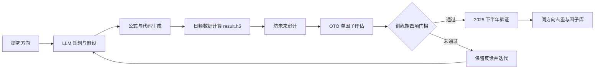

# QuantaAlpha 近期项目工作总结

> 汇报范围：2026 年 9 月 23 日至 11 月 11 日。依据项目代码、配置、运行产物及与 Codex 的项目聊天记录整理。

## 项目定位与流程

QuantaAlpha 是 LLM 驱动的量化因子挖掘系统。研究人员输入方向后，系统规划候选方向，生成假设与因子公式，编写并执行计算代码，得到每只股票每日的因子值；随后进行防未来审计、单因子 OTO 回测、训练期筛选、验证期观察和相似因子去重。前端提供挖掘、过程追踪、因子库、回测和配置入口。

模块职责：数据层提供 Qlib/HDF5 因子输入和 Mongo OTO 行情；规划与进化层负责原始方向、变异和交叉；编码层解析公式、运行因子脚本；评估层完成时间对齐、前视审计、指标与筛选；追踪层保存运行事件和产物；Web 层负责发起任务、查看过程、图表、因子库和参数。

## 因子如何回测与评价

先执行公式得到每只股票每日的因子值，检查覆盖率，并用静态检查与历史数据截断重算审计未来信息。随后按交易日历，用上一交易日收盘后可知的因子值在下一交易日开盘形成持仓，按 OTO 口径计算至再下一交易日开盘的收益。每个因子独立回测：按因子值排序，看每日 IC、十分组收益、多空差及扣费后的头组相对等权基线收益。先用 2023 年至 2025 年上半年训练期评价预测性、稳定性和收益，再观察通过筛选的因子在 2025 年下半年的延续情况，并检查同方向相似因子。当前配置为每日调仓。

## 9 月 23 日以来的工作与结果

| 时间 | 重点工作 | 结果 |
|---|---|---|
| 9/23–9/28 | 合并项目改进，扩充 Mongo 日频字段并在设置页展示；修复 `$pe`/`$pe_ttm`、`$amount`/资金流字段的子串替换冲突 | 新字段进入因子计算；精确 token 替换通过针对性测试。随后发现挖掘模板和重评数据源仍需补齐 |
| 10 月 | 补齐挖掘模板字段替换；排查重评路径、日志空白期和因子库图表加载 | 模板真实数据抽样 10,000 行获得 9,711 条非空值；明确长时间无新日志可发生在计算/审计阶段；图表空白属于加载展示问题，已有回测产物可读 |
| 11/2–11/9 | 六组新增日频字段问题的端到端测试，修复防未来审计的空值误拒并复评 | 六组共生成 91 个公式、90 个 `result.h5`；问题 5 的 6 个误拒复评通过；问题 6 的 15/15 个因子完成审计和回测，有效值占比 91.74%，但均未通过性能门槛 |
| 11/9–11/11 | 分钟频接入方案调研与设计 | 已明确“分钟数据现场计算 → 每股每日一个值 → 复用日频审计和 OTO 回测”的方向；仍需确认 bar 时间含义、权威粒度和数据完整时点，尚未完成正式接入 |

六组测试的有效值占比分别为 95.59%、93.56%、88.77%、96.57%、91.17%、91.74%。问题 1 的一个公式缺少因子计算产物；问题 3 的一个因子曾被旧审计规则拒绝。问题 6 的 IC 中位数约 -0.00146，说明新字段链路的工程可行性得到验证，但当前候选公式尚未提供足够稳定的预测与收益表现。

## 下一步

1. 固化六组测试的异常分类和回归用例，复核尚未生成产物的公式及旧审计拒绝记录；将工程成功率、覆盖率与因子绩效分别汇报。
2. 对因子生成方向和公式语义做有针对性的改进，用训练期与验证期表现、去重和稳定性评估筛选候选，避免仅增加生成数量。
3. 与数据提供方确认分钟 bar 的时间戳、09:30/15:00 含义、1 分钟权威口径及盘后修订时点；先做完整性扫描，再实现分钟算子、按公式现场计算、转日频结果和防未来检查。
4. 对耗时计算增加可见的阶段与耗时信息，并继续完善因子库图表错误提示、追踪产物管理和资源效率。

注：分钟方案文档中的“三日调仓”为目标方案，当前 `configs/evaluation.yaml` 实际设置为一日调仓，正式实施前需统一口径。

## 依据

- `README.md`、`docs/新版回测与因子筛选流程说明.md`、`docs/ADR-OTO单因子评估.md`
- `configs/evaluation.yaml`、`docs/plans/分钟频数据接入方案.md`
- `data/run_traces/` 中六组运行摘要与 11 月 9 日项目聊天核验记录
